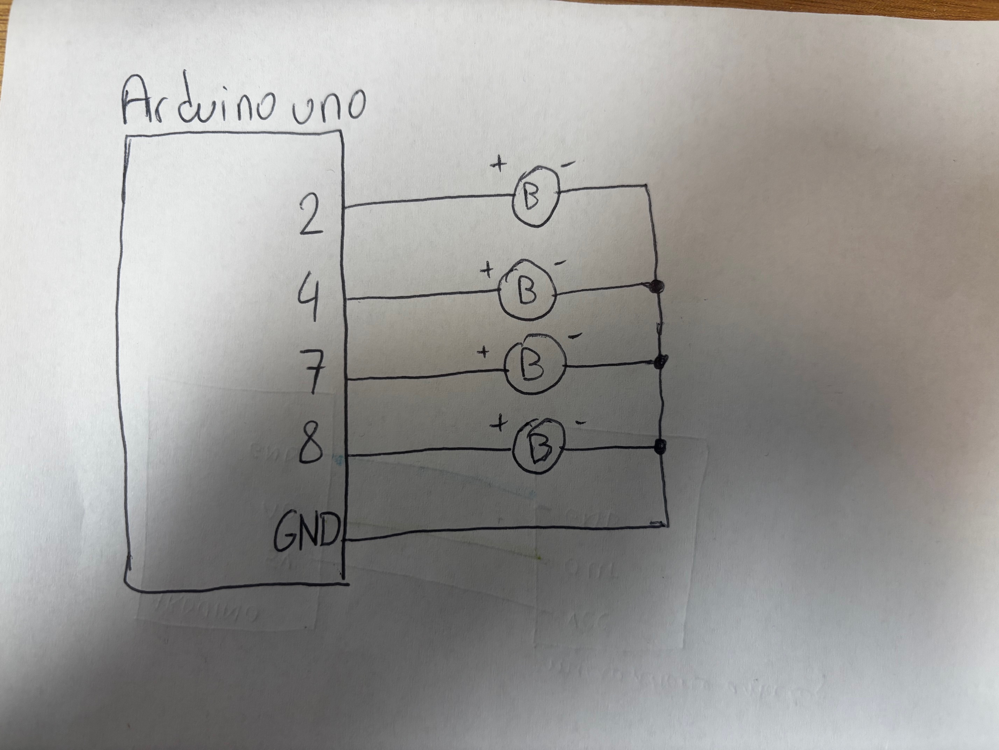
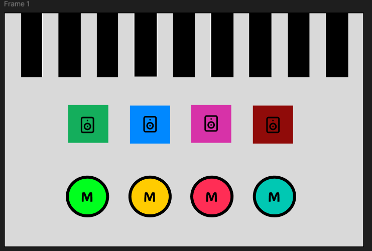
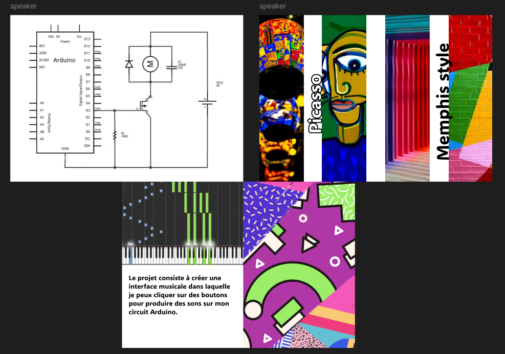
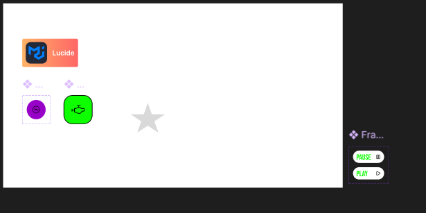
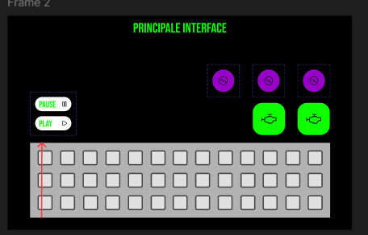
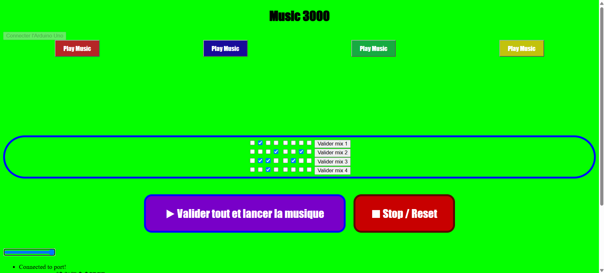

# Eric Music3000

Je vous présente mon projet Music3000 : un site internet pour faire des petits sons, pour des backgrounds de soirées et pour créer d'excellentes musiques (rap ou pop).

Voici la table des matières de mon rendu
- [Code of the electronic part↗](test_project_final/test_project_final.ino)
- [schematic view](#schematic-view)
- [Moodboard](#moodboard)
- [UI on figma](#figma-ui)
- [Code of the web part↗](dww/index.html)
- [Video](#video)

## schematic view
<picture>
    
</picture>

## Moodboard

<picture>
  
    
    >
</picture>

## Figma UI

  
    

>[!TIP]
`[figma UI↗](https://www.figma.com/design/XQfYKIovqEtztlQs7ewNzt/Lacroix-eric-project?node-id=9-597&p=f&t=QEeGZQ3T53uwRozu-0)`
`[figma moodboard↗](https://www.figma.com/design/XQfYKIovqEtztlQs7ewNzt/Lacroix-eric-project?node-id=0-1&p=f&t=QEeGZQ3T53uwRozu-0)`

## Web part
Here is a preview of the assignment. 

## Video

[See the video on youtube↗](https://youtube.com/shorts/02HOC8u6-NM?is=Oa7l49GQVZmnvBeR)

<video src="images/ErikaXeric.mp4" width="640" height="360" controls>
video CrossOver Erika x Eric ;
</video>

<video src="images/ErikaXeric2.mp4" width="640" height="360" controls>
video CrossOver Erika x Eric suite ;
</video>
